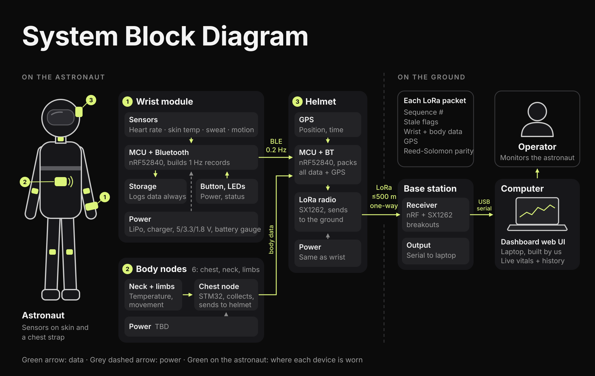

# Astronaut Biometric Sensor Array

Capstone project: a remote monitoring system for astronauts. Sensor nodes
worn on the body measure biometric and environmental data. A head-worn
transmitter packages it with GPS and sends it long distance over LoRa to a
base station, which shows it in a web UI.

## How the system works



```
 biometric-wrist ──┐
 (HR, perspiration,│ BLE
  respiration,     │
  skin/core temp)  ├──▶ head-module ──── LoRa (long range) ────▶ base-station ── USB serial ──▶ base-station web UI
                   │    (packages node data
 environmental-body│     + GPS into one packet)
 (temperature,  ───┘
  body movement)
```

1. **biometric-wrist** measures heart rate, perspiration, respiration, skin
   temperature and core temperature.
2. **environmental-body** nodes measure environmental factors such as
   temperature and body movement.
3. Both report to the **head-module**, which packages their data together
   with GPS and sends it over LoRa. The byte format is in
   [docs/protocol.md](docs/protocol.md).
4. The **base-station** receives the LoRa packets and sends them over USB
   serial to the [base-station web UI](devices/base-station/web-ui).

The **testing web UIs** in [tools/](tools) are a different thing: they read
one node directly over serial or BLE (heart rate, for example) and show it
on a phone or laptop, with no LoRa link needed. They may be generalized to
work with every node later.

## Devices

| Device | What it measures / does | Where it's worn | MCU | Owning team |
|---|---|---|---|---|
| [biometric-wrist](devices/biometric-wrist) | Heart rate, perspiration, respiration, skin temp, core temp | Wrist | nRF52840 (Zephyr) | ENV team |
| [environmental-body](devices/environmental-body) | Environmental factors: temperature, body movement | Body | STM32 | BIO team |
| [head-module](devices/head-module) | Packages node data + GPS, transmits over LoRa | Head | nRF52840 (Zephyr) | ENV team |
| [base-station](devices/base-station) | Receives LoRa, forwards over USB serial to the web UI | Not worn (ground) | TBD | BIO team |

Code owners for each path are listed in [.github/CODEOWNERS](.github/CODEOWNERS).

## Repo layout

| Folder | What goes there |
|---|---|
| [devices/](devices) | Everything that ships as part of the real system. One folder per device, each with `firmware/`, `tests/` and a README. |
| [common/](common) | Code used by **two or more** devices: [protocol](common/protocol), [drivers](common/drivers), [utils](common/utils). |
| [hardware/](hardware) | Schematics, PCB and enclosures, one folder per device. |
| [tools/](tools) | Development and test support that doesn't ship: the test base station, testing web UIs, sensor bring-up firmware, flash scripts. |
| [tests/](tests) | System-level, integration and hardware-in-the-loop tests that need more than one device. |
| [docs/](docs) | [Architecture](docs/architecture.md), [protocol](docs/protocol.md), [onboarding](docs/onboarding.md). |

Folders are organized by device, never by team. Device names put the
function first, then the location (`biometric-wrist`, `environmental-body`).

## Where to start

- New to the project: [docs/onboarding.md](docs/onboarding.md).
- Working on a device: open its README under [devices/](devices). Each
  device has its own toolchain; there's no single build for the whole repo.
- Most work is still prototyping, so the current code is under
  [tools/bringup](tools/bringup); see [tools/README.md](tools/README.md).
